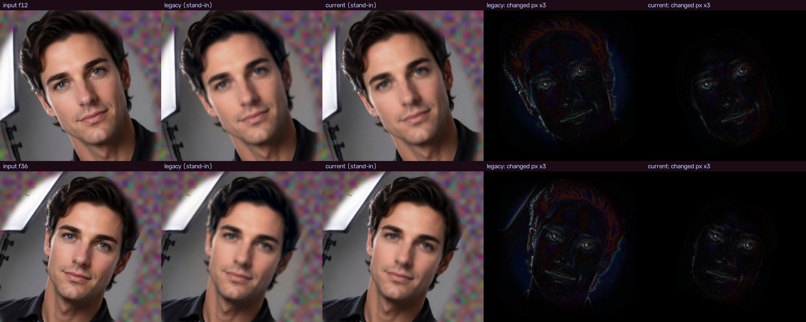

# Face geometry: findings, fixes and how to compare

Scope: the AlphaFace / inswapper face-swap path (`deepfake webcam`, `virtualcam`, `video`). For authorized
footage and synthetic fixtures only; the consent notice and watermark are unchanged.

## What was measured, and where

Everything below was measured on 2026-11-13 in a container with **no GPU and no swap weights**
(AlphaFace needs CUDA and a 1.9 GB checkpoint). So:

* Geometry that does not depend on the swap model was measured for real: where the face lands in the crop
  the model is given, how much it drifts, how far the composite reaches outside the face, and what the capture
  resize does to proportions. Detector: the pinned YuNet weights. Landmarks: MediaPipe Face Landmarker.
* The swap itself was replaced by a labelled **stand-in** (tint + blur of the crop). It makes the composite
  mask visible; it says nothing about how AlphaFace renders eyes.
* The reported symptoms (oversized eyes, stretched face, visible seams) were **not reproduced with the real
  model**. The causes below are verified in the code and in the geometry measurements; that they account for
  what you saw has to be confirmed on the workstation with one command (see "Compare on your own clip").

Fixture: the bundled `bench_face.jpg` moved, scaled ±10% and rolled ±18° over 48 frames at 960×540, with sensor
noise. Report: `docs/geometry/report-synthetic-cpu.json`.

| | legacy | landmark (YuNet points) | **current** (MediaPipe points) |
| --- | --- | --- | --- |
| Roll left in the crop, mean / max | 11.4° / 20.5° | 2.6° / 9.2° | **0.2° / 0.5°** |
| Eye distance as a fraction of the crop, std | 0.0055 | 0.0061 | **0.0012** |
| Landmark drift inside the crop | 7.3 px | 2.3 px | **0.5 px** |
| Composite changes outside the face (× face area) | 0.42 | 0.0001 | **0.0** |
| Frame-to-frame change of the overlay (flicker) | 4.38 | 2.46 | **1.99** |
| CPU time per frame, stand-in swap | 12.7 ms | 13.1 ms | 22.8 ms |
| Peak VRAM | not measured (no GPU) | | |

4:3 camera into the 16:9 `balanced` preset, eye-distance ÷ eye-to-mouth relative to the camera frame:
**stretch (legacy) 1.34**, cover 1.01, contain 1.00.



Left to right: input, legacy composite, current composite, then the pixels each one changed (×3). The legacy
composite alters hair, ears and background around the face; the current one stays on the face.
`geometry/model-input-crops.jpg` shows the crops handed to the swap model; `geometry/aspect.jpg` the capture resize.

## Causes found

1. **Live capture stretched the frame.** `CaptureThread` and `run_loop` resized every camera frame to the
   preset size with independent x and y scale. A camera that ignores the size hint and delivers 4:3 into a
   16:9 preset comes out 33% wider: a stretched face before any model runs. Offline `video` was not affected
   (it uses the file's own size). Fix: `fit="cover"` (uniform scale, centre crop); `contain` and `stretch` selectable.
2. **The crop ignored the landmarks.** The target crop was an axis-aligned square around the detector box,
   padded 35%. Head roll went straight into the model input (up to 20° on the fixture), and the face's scale
   and position in the crop followed the box, which jitters. A swap generator trained on aligned faces
   synthesises features where and how large it expects them; feeding it a tilted, drifting face is the
   plausible source of mis-sized or misplaced eyes. Fix: a similarity transform from five landmarks to a fixed
   template (uniform scale, so proportions cannot change), and the paste through the exact inverse of the
   same matrix.
3. **The identity image was not ArcFace-aligned.** The source face went to the ArcFace encoder as a padded
   box crop squeezed to 112×112. That encoder is trained on the five-point ArcFace alignment. Fix: align the
   identity crop to the ArcFace reference points.
4. **The composite mask covered the padded box, not the face.** A fixed oval inset 6% from the crop edge,
   on a crop padded 35% beyond the detector box, blends generator output over hair, ears, neck and background.
   Any colour or texture difference shows as an oval seam there, and the LAB colour match computed its
   statistics over that same region, background included. Fix: an ellipse placed from the template landmarks,
   feathered to zero inside the crop, warped back with the crop transform.
5. **Detections were reused across frames without re-measuring.** With `detect_interval` 2 or 3 the crop
   stayed where the face was one or two frames ago. Fix: the landmark pass runs on the current frame for a
   reused box (sync modes).
6. **YuNet's landmarks are too coarse to align with at its working resolution.** Found while testing fix 2:
   at ≤640 px detection width, on a face about 90 px wide rolled 16°, YuNet reports about 2° of roll. A second
   pass on the face region helps (mean roll error 1.7°, max 7.8°), and MediaPipe Face Landmarker is far better
   on the same frames (0.26° mean, 0.8° max, about 10 ms per frame on CPU).

Not a cause: there is **no restoration or enhancement pass** in this pipeline, so nothing downstream of the
swap can be changing proportions. The crop-to-paste round trip of the legacy path is also self-consistent
(it pastes into the rectangle it cropped), so there is no mismatch of coordinate spaces there.

## What changed

| Setting | Default | Legacy value | CLI |
| --- | --- | --- | --- |
| `alignment` | `landmark` | `bbox` | `--align` |
| `align_template` | `ffhq` | n/a | `--align-template ffhq\|arcface` |
| `mask_mode` | `landmark` | `oval` | `--mask` |
| `landmarker` | `auto` (MediaPipe when installed, else refined YuNet) | `yunet` | `--landmarker` |
| `landmark_smooth` | on (One Euro filter) | off | `--landmark-smooth/--no-landmark-smooth` |
| `identity_align` | `arcface` | `bbox` | `--identity-align` |
| `fit` | `cover` | `stretch` | `--fit` |

`--legacy-geometry` sets every legacy value at once. The same keys work in `~/.config/deepfake/config.toml`
and in the widget (Engines → Face geometry).

MediaPipe is optional: `pip install 'deepfake[landmarks]'` and
`deepfake models install face-landmarker --yes` (3.6 MB, Apache-2.0, sha256-pinned). Without it the refined
YuNet points are used.

**One default is a judgement call, not a measurement.** The template decides how large the face is in the
crop. `ffhq` (eye distance = 25% of the crop) was chosen because the legacy crop averaged 23.6–25%, so the new
default changes roll, drift and masking without changing the framing AlphaFace has been seeing. `arcface`
(31.5%) is what inswapper-family models are trained on. AlphaFace's upstream evaluation code takes
pre-aligned images and does not document the alignment, so which template suits its checkpoint best is an
open question that only a run with the weights can answer.

Every rendered video now gets `<output>.deepfake.json`: version, engine, backend, the installed model record
(revision / hashes), detector, preset, every geometry and composite setting, frame generation, and the run
summary. The widget's dashboard shows the geometry of the running session.

## Compare on your own clip

```bash
deepfake compare -i clip.mp4 -f face.png -o compare-out --frames 96 --variant legacy --variant current --variant arcface-template
```

That runs the same frames through each variant with the installed swap model and writes per-variant
frames, `sheet.jpg`, `crops.jpg` and `report.json` (eye proportions of the output against the input,
crop-space drift, change outside the face, flicker, ms per frame, peak VRAM). Add
`--variant name:key=value,...` for any other combination. Without `-i` it uses the synthetic fixture; without
an installed swap model it uses the stand-in and says so.

What to look at: `output eye/mouth ratio vs input` should be close to 1.0 (oversized eyes push it up);
check profile and occluded frames in `sheet.jpg` by eye, since the five-point fit is weakest there.

## Shortlist: not adopted, not tested here

Candidates from current literature with code or weights, for a later A/B with `deepfake compare`. None was
run in this work (no GPU), and licences marked "check" were not confirmed from a primary source.

| Candidate | For | Code / weights | Licence | Fit on 24 GB | Why not now |
| --- | --- | --- | --- | --- | --- |
| MediaPipe Face Landmarker (478 points) | alignment, later a mesh-shaped mask and occlusion handling | yes | Apache-2.0 | CPU, ~10 ms | **adopted** as the optional landmark source; the mesh mask is the next step |
| InsightFace `2d106det` / SCRFD | denser landmarks | yes (buffalo_l) | non-commercial research | trivial | licence; already downloaded only for the inswapper fallback |
| VividFace (arXiv 2412.11279, NeurIPS 2025) | temporally consistent diffusion video swap | project page says code and weights | check | diffusion video model; likely offline only | offline, heavy; licence not confirmed |
| DynamicFace (arXiv 2501.08553) | 3D-prior video swap with temporal attention | not confirmed | check | unknown | no confirmed release |
| VFace (arXiv 2602.07835) | training-free diffusion video swap | github.com/Sanoojan/VFace | check (paper CC BY 4.0) | unknown | code licence not confirmed |
| CanonSwap | canonical-space motion / appearance separation | not confirmed | check | unknown | no confirmed release |
| GFPGAN v1.4 / CodeFormer / RestoreFormer++ | face restoration after the swap | yes | Apache-2.0 / S-Lab non-commercial / Apache-2.0 (from memory; check) | small | a restoration pass regenerates eyes and mouth and can itself shift proportions; add only behind a flag and only if `compare` shows the ratio stays at 1.0 |

Sources: [VividFace](https://arxiv.org/pdf/2412.11279), [DynamicFace](https://arxiv.org/html/2501.08553v2),
[VFace](https://fugumt.com/fugumt/paper_check/2602.07835v1_enmode),
[face swapping survey and benchmark](https://arxiv.org/pdf/2605.00883),
[AlphaFace eval code](https://raw.githubusercontent.com/andrewyu90/Alphaface_Official/main/eval.py),
One Euro filter (Casiez et al., CHI 2012).

## Known limits

* Live modes take boxes from the previous frame by design (detection runs on its own thread), so the
  landmark re-measure in fix 5 applies to `video` and the synchronous path, not to `webcam`.
* Five points give a similarity transform. Strong yaw or pitch is not modelled; the crop is still upright
  and scaled, but a profile face fills the template differently from a frontal one.
* The landmark mask is an ellipse. Hands or hair in front of the face are composited over, as before.
